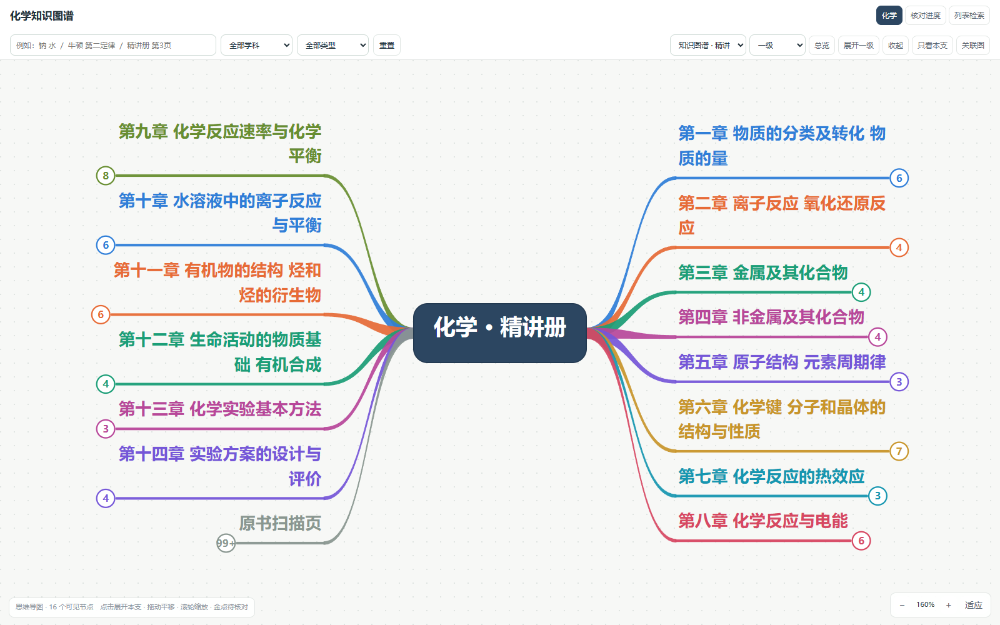

# 高中化学知识图谱

这是 `wuli2025/knowledge` 的 **chemistry（化学）独立分支**，仅包含化学内容。

- [数学主分支](https://github.com/wuli2025/knowledge/tree/main)
- [另一学科分支](https://github.com/wuli2025/knowledge/tree/physics)

## 打开方式

下载本分支完整文件，双击根目录 `index.html`。无需服务器、无需联网。
请保持 `index.html`、`assets/`、`pages/` 的相对位置不变。
GitHub 的文件预览显示 HTML 源码；浏览图谱请下载后在浏览器打开。



## 展示与检索

沿用数学知识图谱的左右分支排布：章节／小节 → 知识点 → 概念、规律、方法及题目。
章节是彩色文字分支，具体知识和题目是正文／公式卡片。
点击分支展开或收起；支持一级至五级展开、只看本支、拖动平移和滚轮缩放。
搜索可查标题、正文、答案及出处，点击结果定位到导图节点。
“关联图”展示条目已有关系；右侧可查看答案、关联依据和原书扫描页。
精讲册、精练册、答案册可以分别浏览，也可切回列表检索。

## 本分支规模

| 内容 | 数量 |
| --- | ---: |
| 原书扫描页／已完成OCR页 | 457 / 457 |
| 全部条目（含原页、章节、答案等） | 5159 |
| 题目条目 | 977 |
| 概念／规律／方法条目 | 1788 |
| 已导入机器整理小节 | 67 |
| 结构配对的题目答案 | 429 |
| 已记录关系 | 12123 |

来源：2027《5年高考3年模拟》化学精讲册、精练册、答案册及本地精编专题。
页码使用PDF物理扫描页序号，不一定与印刷页码相同。

## 核对状态

OCR覆盖完成不等于全书逐字校对完成。机器整理、自动配对和术语关联仍明确标注待核对。
已做结构校验、公式渲染检查和分章抽样核对；复杂图形、题目边界及未确认结论应对照原扫描页。
不为未配对的题目补造答案，也不把术语候选关联当作人工确认的考点。

## 文件与更新

- `index.html`：内嵌数据的离线思维导图入口。
- `data/knowledge.json`：本学科条目、关系、出处与统计。
- `专题数据/化学/`：精编专题JSON。
- `structured/化学/`：按小节保存的机器概念、规律与方法及来源引用。
- `ocr/化学/`：原书OCR转写。
- `pages/化学/`：原书扫描图。
- `assets/katex/`：本地公式渲染资源及随附许可文件。
- `kb_view.html`、`mindmap*.js`、`mindmap.css`、`build_view.py`：页面模板、导图与构建代码。

修改本分支 `data/knowledge.json` 或展示代码后，在根目录运行：

```console
python build_view.py
```

该命令只重建页面。`structured/`、`ocr/`、`专题数据/` 保留整理来源；修改这些来源文件后，
需先通过整理流程更新 `data/knowledge.json`，再构建页面。原始合并版仍保留在本地理化目录。
本分支没有上传执行日志、临时文件、账号信息或本机配置，也不改变数学 `main` 分支。
